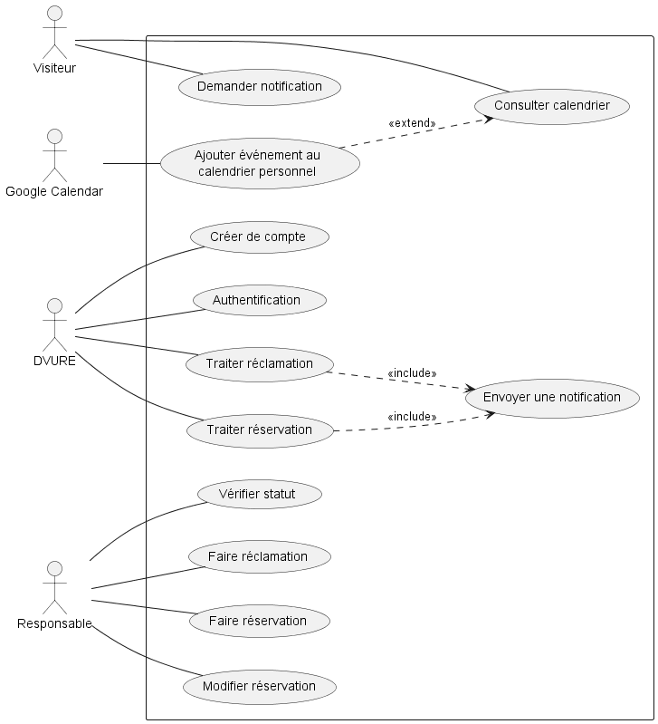
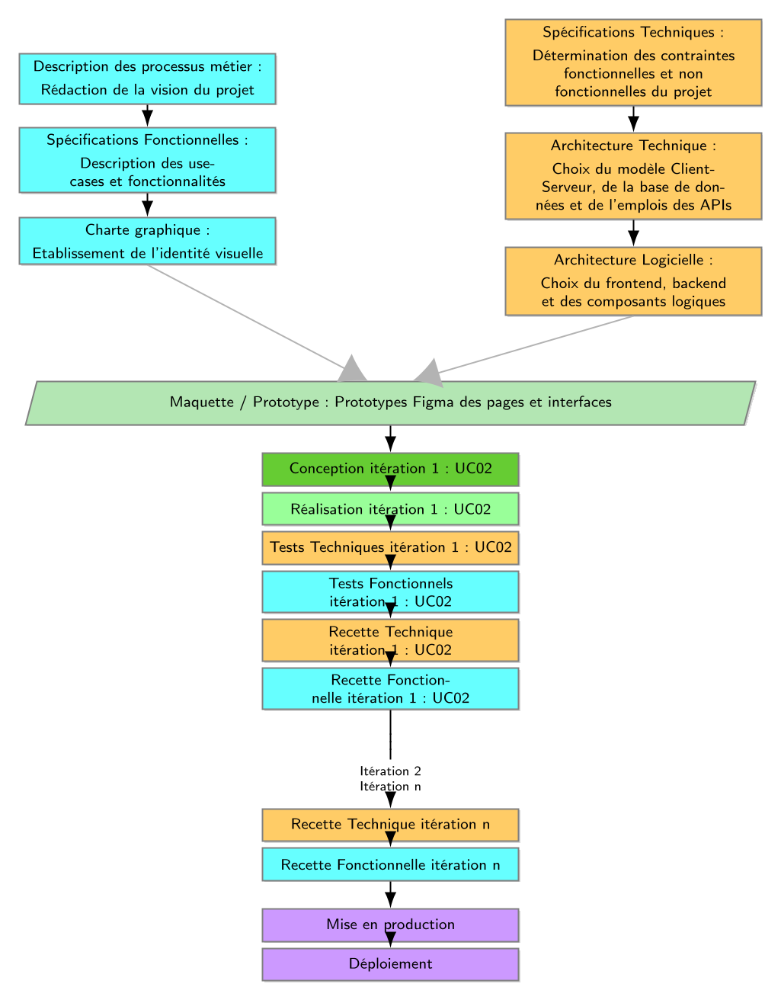

# INSAT Community Calendar API

**Mini-projet de Processus Unifiés et Approches Agiles**

Gestion des événements, des réservations et des réclamations destinée à la communauté INSAT.

## 1. Présentation du projet

### Vision

INSAT Community Calendar vise à centraliser la gestion et la consultation des événements de la communauté INSAT.

La plateforme permet aux responsables de gérer les événements, de traiter les réservations et les réclamations, et de communiquer avec les utilisateurs grâce à un système de notifications.

Les visiteurs peuvent consulter le calendrier et demander des notifications concernant les événements qui les intéressent.

L'intégration avec Google Calendar permet également d'ajouter certains événements à un calendrier personnel.

Le projet cherche à améliorer l'accès à l'information, à simplifier la gestion des événements et à assurer un suivi cohérent des opérations.

### Acteurs

| Acteur | Responsabilités |
|---|---|
| DVURE | Administration: Traiter les réservations, les réclamations et les opérations de gestion des comptes. |
| Responsable | Responsable de l'événement: Effectuer et modifier des réservations, vérifier leur statut et soumettre des réclamations. |
| Visiteur | Consulter le calendrier et demander des notifications. |
| Google Calendar | Service externe permettant l'ajout d'événements à un calendrier personnel. |

## 2. Cas d'utilisation

Le projet comprend les cas d'utilisation suivants, organisés selon les besoins des différents acteurs.

| Référence | Cas d'utilisation |
|---|---|
| UC01 | Traiter une réclamation |
| UC02 | Traiter une réservation |
| UC03 | Envoyer une notification |
| UC04 | Créer un compte |
| UC05 | Authentification |
| UC06 | Faire une réservation |
| UC07 | Modifier une réservation |
| UC08 | Vérifier le statut d'une réservation |
| UC09 | Faire une réclamation |
| UC10 | Consulter le calendrier |
| UC11 | Demander une notification |
| UC12 | Ajouter un événement au calendrier personnel |

Les cas d'utilisation UC01 et UC02 incluent l'envoi d'une notification. UC12 étend la consultation du calendrier et implique l'interaction avec Google Calendar.

### Diagramme de cas d'utilisation

Le diagramme suivant présente les acteurs, les fonctionnalités du système et leurs relations.



*Source : `docs/use_case.puml`.*

## 3. Priorisation des cas d'utilisation

Les cas d'utilisation sont évalués selon trois critères :

- **Valeur métier :** contribution à l'objectif principal du projet.
- **Risque technique :** difficulté d'implémentation ou incertitude technique.
- **Impact architectural :** influence sur la structure et les composants du système.

| Cas d'utilisation | Valeur métier | Risque technique | Impact architectural | Priorité |
|---|---|---|---|---|
| UC02 : Envoyer une réservation | Élevée | Élevé | Élevé | Très haute |
| UC03 : Modifier une réservation | Moyen | Élevé | Moyen | Haute |
| UC05 : Authentification | Faible | Moyen | Faible | Haute |
| UC06 : Traiter une réservation | Élevée | Élevé | Élevé | Très haute |
| UC10 : Consulter le calendrier | Faible | Faible à moyen | Faible | Moyenne |
| UC12 : Demander modification | Faible | Faible | Faible | Moyenne |

Cette priorisation met en évidence les réservations comme un élément central du système. Leur traitement peut nécessiter une gestion rigoureuse des conflits, de la disponibilité des ressources et des accès concurrents.

## 4. Architecture technique

### Technologies

| Composant | Technologie |
|---|---|
| Environnement serveur | Node.js |
| Framework backend | NestJS |
| Type d'API | REST |
| Base de données | SQLite |
| Modélisation | UML et PlantUML |
| Gestion du code source | Git et GitHub |
| Tests | Tests automatisés adaptés aux composants développés |

### Architecture logicielle

Le projet adopte une architecture backend organisée en couches afin de séparer les responsabilités :

1. **Contrôleurs :** réceptionnent les requêtes HTTP et exposent les routes de l'API.
2. **Services :** contiennent la logique métier et les règles de gestion.
3. **Accès aux données :** assurent les interactions avec la base de données SQLite.
4. **Base de données :** conserve les données nécessaires au fonctionnement de l'application.

Cette séparation facilite la maintenance, les tests et l'évolution du système.

### Diagramme 2TUP

Le diagramme suivant présente l'organisation du processus de développement, depuis les besoins fonctionnels et les choix techniques jusqu'au prototypage, aux itérations et au déploiement.



*Source : `docs/Diagramme_2TUP.png`.*

## 5. Contraintes techniques

Les principales exigences techniques identifiées sont les suivantes.

| Catégorie | Exigence |
|---|---|
| Performance | Gérer les pics de charge et limiter les délais de réponse. |
| Plateforme | Exposer une API utilisable par différentes interfaces clientes. |
| Sécurité | Prévoir une authentification robuste et étudier la mise en place d'une authentification à deux facteurs (2FA). |
| Architecture | Séparer la logique métier, les contrôleurs et l'accès aux données au moyen d'une API REST. |
| Traçabilité | Prévoir un historique des opérations et des statistiques pertinentes. |
| Synchronisation | Maintenir la cohérence des disponibilités et des statuts de réservation. |
| Intégration | Permettre l'interaction avec Google Calendar pour les fonctionnalités concernées. |

Ces contraintes orientent les choix d'architecture et les scénarios de test.

## 6. Organisation du développement

Le projet suit une démarche inspirée du Processus Unifié, avec quatre phases : Inception, Élaboration, Construction et Transition.

### Planification des itérations

| Itération | Objectif principal |
|---|---|
| Itération 1 | Mettre en place l'architecture de base et traiter prioritairement le cas d'utilisation à risque technique. |
| Itération 2 | Implémenter les fonctionnalités principales de gestion des événements et des réservations. |
| Itération 3 | Compléter les fonctionnalités restantes, renforcer les tests et préparer la transition. |

Les quatre phases structurent le cycle de vie du projet, tandis que les itérations permettent de développer et de valider progressivement les fonctionnalités.

## 7. Gestion du projet avec Git et GitHub

Le dépôt GitHub centralise le code source, les diagrammes et le suivi des tâches.

L'organisation repose sur les éléments suivants :

- **Issues :** suivi des cas d'utilisation et des tâches associées.
- **Branches :** développement isolé de chaque cas d'utilisation.
- **Milestones :** regroupement des tâches par phase ou objectif de livraison.
- **Tags :** identification des jalons importants du projet.
- **Pull requests et revues :** intégration et vérification des modifications avant leur fusion.

Le flux de travail recherché suit la chaîne :

**UC → Issue → Branche → Conception → Implémentation → Tests → Revue → Fusion**

Les jalons doivent permettre d'identifier les livrables validés à chaque étape du projet.

La fusion intervient après l'implémentation, les tests et la revue des modifications. Elle permet d'intégrer les fonctionnalités validées dans la branche cible du projet.

## 8. Choix de l'UC à risque technique

### Quelle contrainte technique a influencé le choix de l'UC à risque ?

La gestion des réservations est un candidat pertinent en raison des contraintes de concurrence et de cohérence des données. Plusieurs utilisateurs peuvent tenter de réserver la même ressource pendant une période proche.

Le système doit éviter les doubles réservations et maintenir un état cohérent des disponibilités. Cette exigence influence la logique métier, les accès à SQLite et les tests d'intégration.

## 9. Installation et exécution

### Prérequis

- Node.js et npm.
- Git.
- Le dépôt du projet.

### Installation

Cloner le dépôt :

```bash
git clone https://github.com/zakarialahrizi/insat_community_calendar.git
cd insat_community_calendar
```

Installer les dépendances :

```bash
npm install
```

### Exécution

Les commandes exactes dépendent des scripts définis dans `package.json`. Pour un projet NestJS standard, les commandes suivantes sont généralement disponibles :

```bash
npm run start:dev
```

Pour exécuter les tests, si les scripts correspondants sont configurés :

```bash
npm run test
npm run test:e2e
```

Consulter `package.json` pour vérifier les commandes réellement disponibles et les éventuelles variables d'environnement nécessaires.

## 10. Structure documentaire

Les diagrammes sont versionnés dans le dépôt afin de conserver une trace des décisions de conception.

```text
insat_community_calendar/
├── docs/
│   ├── use_case.puml
│   ├── usecase.png
│   └── Diagramme_2TUP.png
├── src/
├── test/
├── package.json
└── README.md
```

Cette arborescence est indicative. Elle doit être ajustée à la structure réelle du dépôt.

## 11. Conclusion

Ce projet applique les principes du Processus Unifié à la réalisation d'une API de calendrier communautaire. Il associe la modélisation UML, la planification par itérations, le suivi des cas d'utilisation avec GitHub et une architecture backend en couches.

L'objectif est de faire évoluer progressivement le système, en traitant en priorité les risques techniques, en validant les fonctionnalités par des tests et en assurant la traçabilité des livrables.

---

**Projet universitaire : Processus Unifiés et Approches Agiles**

Dépôt GitHub : [insat_community_calendar](https://github.com/zakarialahrizi/insat_community_calendar)

